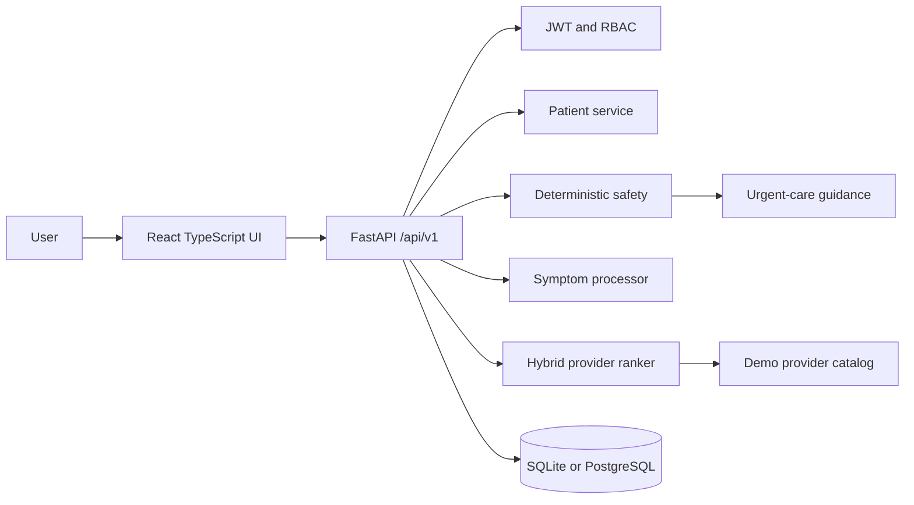

# Architecture

HealthWise AI uses a modular monolith: the React client communicates with versioned FastAPI routers, the service and AI modules remain independent, and SQLAlchemy isolates persistence behind repositories in a later production phase.

Major external services are optional targets rather than mandatory local dependencies: PostgreSQL/pgvector, Redis, MLflow, and an external LLM.
