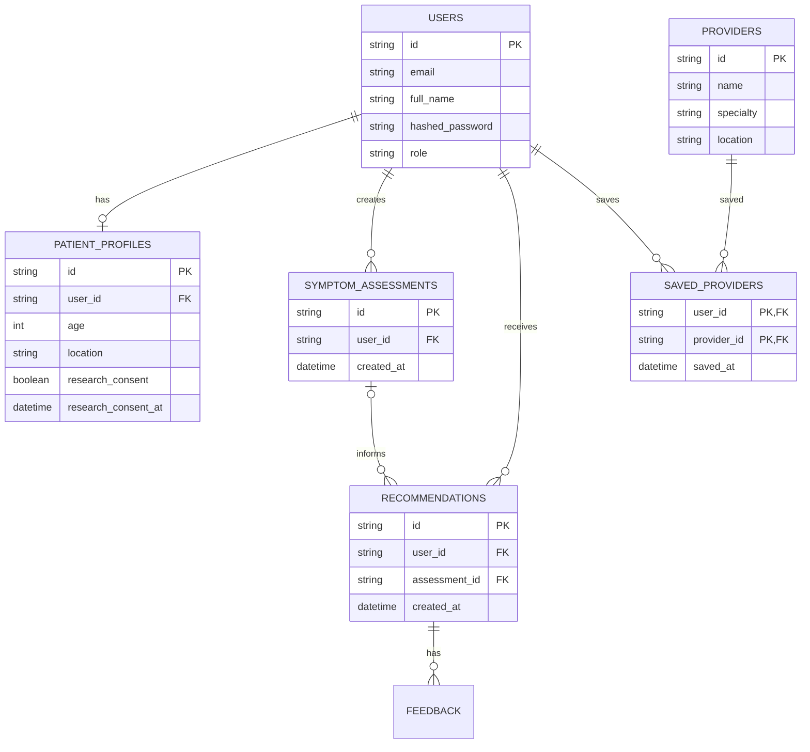

# Database Design

The SQLAlchemy schema contains users, patient profiles, symptom assessments, recommendations, feedback, providers, and a user/provider saved-provider join table. Patient routes scope assessment, recommendation, and saved-provider data to the authenticated user. The canonical local SQLite database is repository-root `healthwise.db`, independent of the process working directory. PostgreSQL is configurable, and schema compilation is tested, but PostgreSQL connectivity and migrations have not been integration-tested.

Revision `0001_saved_providers` creates the saved-provider table. Revision `0002_consent_and_integrity` adds the opt-in consent timestamp and an indexed assessment foreign key for recommendations; it is applied to the canonical SQLite database. SQLite application connections enable foreign-key enforcement. Existing consent timestamps cannot be reconstructed, so legacy values are left null rather than assigned invented dates.

UUID identifiers are stored as strings, and structured payloads use JSON-serialized text for SQLite/PostgreSQL portability. A PostgreSQL-dialect schema compilation test checks DDL generation, not server behavior. A full migration baseline for the pre-existing tables remains incomplete; startup also uses `Base.metadata.create_all`. A separate `backend\\healthwise.db` created by earlier working-directory-dependent runs was retained and not merged into the canonical database.
